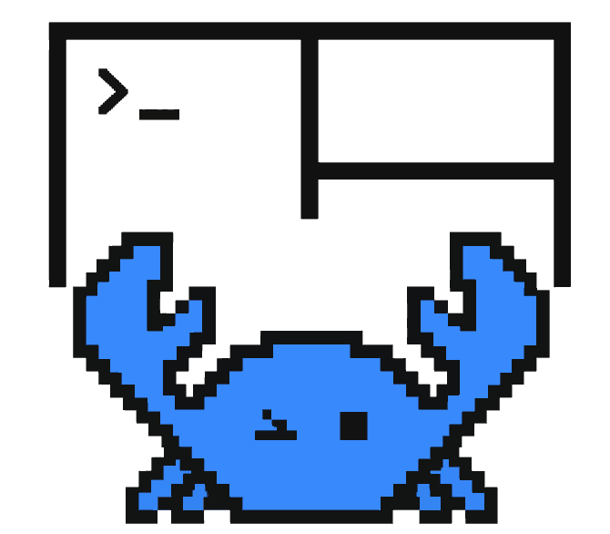
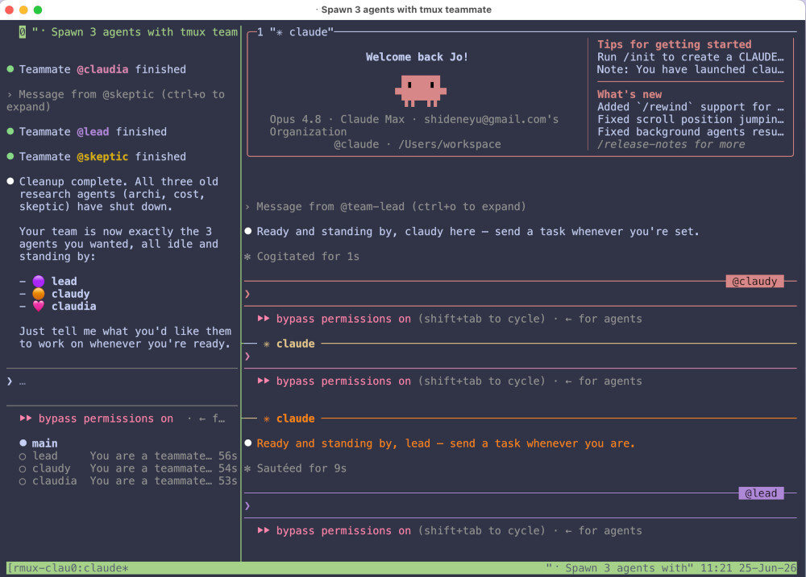

<picture><source media="(min-width: 1360px)" srcset="docs/sidebar/readme-desktop-left-spacer.svg"></picture>
<div><picture><source media="(min-width: 1360px) and (prefers-color-scheme: dark)" srcset="docs/sidebar/readme-desktop-sidebar-row-top-dark-v4.svg"><source media="(min-width: 1360px)" srcset="docs/sidebar/readme-desktop-sidebar-row-top-light-v4.svg"></picture><picture><source media="(min-width: 1360px) and (prefers-color-scheme: dark)" srcset="docs/sidebar/readme-desktop-sidebar-row-heading-overview-dark-v4.svg"><source media="(min-width: 1360px)" srcset="docs/sidebar/readme-desktop-sidebar-row-heading-overview-light-v4.svg"></picture><a href="#what-is-rmux"><picture><source media="(min-width: 1360px) and (prefers-color-scheme: dark)" srcset="docs/sidebar/readme-desktop-sidebar-row-item-what-is-rmux-dark-v4.svg"><source media="(min-width: 1360px)" srcset="docs/sidebar/readme-desktop-sidebar-row-item-what-is-rmux-light-v4.svg"></picture></a><a href="#features"><picture><source media="(min-width: 1360px) and (prefers-color-scheme: dark)" srcset="docs/sidebar/readme-desktop-sidebar-row-item-features-dark-v4.svg"><source media="(min-width: 1360px)" srcset="docs/sidebar/readme-desktop-sidebar-row-item-features-light-v4.svg"></picture></a><a href="#quick-start"><picture><source media="(min-width: 1360px) and (prefers-color-scheme: dark)" srcset="docs/sidebar/readme-desktop-sidebar-row-item-quick-start-dark-v4.svg"><source media="(min-width: 1360px)" srcset="docs/sidebar/readme-desktop-sidebar-row-item-quick-start-light-v4.svg"></picture></a><a href="#demos"><picture><source media="(min-width: 1360px) and (prefers-color-scheme: dark)" srcset="docs/sidebar/readme-desktop-sidebar-row-item-demos-dark-v4.svg"><source media="(min-width: 1360px)" srcset="docs/sidebar/readme-desktop-sidebar-row-item-demos-light-v4.svg"></picture></a><picture><source media="(min-width: 1360px) and (prefers-color-scheme: dark)" srcset="docs/sidebar/readme-desktop-sidebar-row-rule-overview-dark-v4.svg"><source media="(min-width: 1360px)" srcset="docs/sidebar/readme-desktop-sidebar-row-rule-overview-light-v4.svg"></picture><picture><source media="(min-width: 1360px) and (prefers-color-scheme: dark)" srcset="docs/sidebar/readme-desktop-sidebar-row-heading-usage-dark-v4.svg"><source media="(min-width: 1360px)" srcset="docs/sidebar/readme-desktop-sidebar-row-heading-usage-light-v4.svg"></picture><a href="#installation"><picture><source media="(min-width: 1360px) and (prefers-color-scheme: dark)" srcset="docs/sidebar/readme-desktop-sidebar-row-item-installation-dark-v4.svg"><source media="(min-width: 1360px)" srcset="docs/sidebar/readme-desktop-sidebar-row-item-installation-light-v4.svg"></picture></a><a href="#web-sharing"><picture><source media="(min-width: 1360px) and (prefers-color-scheme: dark)" srcset="docs/sidebar/readme-desktop-sidebar-row-item-web-sharing-dark-v4.svg"><source media="(min-width: 1360px)" srcset="docs/sidebar/readme-desktop-sidebar-row-item-web-sharing-light-v4.svg"></picture></a><a href="#claude-teammate-mode"><picture><source media="(min-width: 1360px) and (prefers-color-scheme: dark)" srcset="docs/sidebar/readme-desktop-sidebar-row-item-claude-agents-dark-v4.svg"><source media="(min-width: 1360px)" srcset="docs/sidebar/readme-desktop-sidebar-row-item-claude-agents-light-v4.svg"></picture></a><a href="#scripting-api" title="Historical Python SDK for RMUX 0.6.1; excluded from 1.0"><picture><source media="(min-width: 1360px) and (prefers-color-scheme: dark)" srcset="docs/sidebar/readme-desktop-sidebar-row-item-python-sdk-dark-v4.svg"><source media="(min-width: 1360px)" srcset="docs/sidebar/readme-desktop-sidebar-row-item-python-sdk-light-v4.svg"></picture></a><a href="#scripting-api" title="Historical TypeScript SDK for RMUX 0.6.x; excluded from 1.0"><picture><source media="(min-width: 1360px) and (prefers-color-scheme: dark)" srcset="docs/sidebar/readme-desktop-sidebar-row-item-typescript-sdk-dark-v4.svg"><source media="(min-width: 1360px)" srcset="docs/sidebar/readme-desktop-sidebar-row-item-typescript-sdk-light-v4.svg"></picture></a><picture><source media="(min-width: 1360px) and (prefers-color-scheme: dark)" srcset="docs/sidebar/readme-desktop-sidebar-row-rule-usage-dark-v4.svg"><source media="(min-width: 1360px)" srcset="docs/sidebar/readme-desktop-sidebar-row-rule-usage-light-v4.svg"></picture><picture><source media="(min-width: 1360px) and (prefers-color-scheme: dark)" srcset="docs/sidebar/readme-desktop-sidebar-row-heading-resources-dark-v4.svg"><source media="(min-width: 1360px)" srcset="docs/sidebar/readme-desktop-sidebar-row-heading-resources-light-v4.svg"></picture><a href="#documentation"><picture><source media="(min-width: 1360px) and (prefers-color-scheme: dark)" srcset="docs/sidebar/readme-desktop-sidebar-row-item-documentation-dark-v4.svg"><source media="(min-width: 1360px)" srcset="docs/sidebar/readme-desktop-sidebar-row-item-documentation-light-v4.svg"></picture></a><a href="docs/benchmarks.md"><picture><source media="(min-width: 1360px) and (prefers-color-scheme: dark)" srcset="docs/sidebar/readme-desktop-sidebar-row-item-benchmarks-dark-v4.svg"><source media="(min-width: 1360px)" srcset="docs/sidebar/readme-desktop-sidebar-row-item-benchmarks-light-v4.svg"></picture></a><a href="#documentation"><picture><source media="(min-width: 1360px) and (prefers-color-scheme: dark)" srcset="docs/sidebar/readme-desktop-sidebar-row-item-examples-dark-v4.svg"><source media="(min-width: 1360px)" srcset="docs/sidebar/readme-desktop-sidebar-row-item-examples-light-v4.svg"></picture></a><a href="#documentation"><picture><source media="(min-width: 1360px) and (prefers-color-scheme: dark)" srcset="docs/sidebar/readme-desktop-sidebar-row-item-faq-dark-v4.svg"><source media="(min-width: 1360px)" srcset="docs/sidebar/readme-desktop-sidebar-row-item-faq-light-v4.svg"></picture></a><a href="CONTRIBUTING.md"><picture><source media="(min-width: 1360px) and (prefers-color-scheme: dark)" srcset="docs/sidebar/readme-desktop-sidebar-row-item-contributing-dark-v4.svg"><source media="(min-width: 1360px)" srcset="docs/sidebar/readme-desktop-sidebar-row-item-contributing-light-v4.svg"></picture></a><picture><source media="(min-width: 1360px) and (prefers-color-scheme: dark)" srcset="docs/sidebar/readme-desktop-sidebar-row-bottom-dark-v4.svg"><source media="(min-width: 1360px)" srcset="docs/sidebar/readme-desktop-sidebar-row-bottom-light-v4.svg"></picture></div>

<div align="center">

<p align="center">
  <a href="https://rmux.io/">
    <picture>
      <source media="(prefers-color-scheme: dark)" srcset="docs/rmux-logo-dark.svg">
      
    </picture>
  </a>
</p>

<p align="center">
  <a href="https://rmux.io/">
    <picture>
      <source media="(prefers-color-scheme: dark)" srcset="docs/rmux-wordmark-dark.svg">
      
    </picture>
  </a>
</p>

<p align="center"><small><strong>The Universal Multiplexer Engine.</strong></small></p>

<p align="center">
  <picture><source media="(prefers-color-scheme: dark)" srcset="docs/readme-hero-native-dark.svg"></picture>
</p>

<p align="center">
  <picture><source media="(prefers-color-scheme: dark)" srcset="docs/readme-hero-rule-dark.svg"></picture>
</p>

<p align="center"><small>English · <a href="docs/i18n/README.fr.md">Français</a> · <a href="docs/i18n/README.zh-CN.md">简体中文</a> · <a href="docs/i18n/README.ja.md">日本語</a></small></p>

<p align="center">
  <a href="#verification"></a>
  <a href="https://github.com/Helvesec/rmux/actions/workflows/ci.yml?query=branch%3Amain"></a>
  <a href="https://www.bestpractices.dev/projects/13290"></a>
  <a href="#installation"></a>
</p>

</div>

<br clear="all">

> [!NOTE]
> This branch targets the RMUX 0.11.0 candidate. Publication and final artifact qualification are pending. Web Share is experimental; qualification beyond loopback is pending. [Learn more in the docs.](docs/web-share.md)
>
> Historical Python/TypeScript packages target RMUX 0.6: [librmux 0.6.1](https://pypi.org/project/librmux/0.6.1/) and [@rmux/sdk 0.6.5](https://www.npmjs.com/package/@rmux/sdk/v/0.6.5). They are excluded from RMUX 0.11 distributions and SDK support; see [SDK scope](docs/scripting-sdk.md#additional-language-sdk-scope).
>
> If you have a feature request or want to report anything, please [file an issue](https://github.com/Helvesec/rmux/issues).

<p align="center">
  <a href="#documentation">
    
  </a>
</p>

<a id="what-is-rmux"></a>

## 🧭 What is RMUX?

RMUX is an async, typed terminal multiplexer engine written in Rust. It implements 90+ `tmux` commands and runs natively on Linux, macOS, and Windows with no WSL required.

Use it as a standalone CLI, embed it in Rust terminal apps, or automate it through the typed Rust SDK. Historical Python/TypeScript wrappers target RMUX 0.6; their 0.11 qualification is deferred.

## Experimental Kitty keyboard

Kitty Keyboard is disabled by default and is not qualified as full protocol
support. The default build ignores Kitty keyboard negotiation and keeps legacy
and xterm extended-key handling. Kitty graphics is a separate capability.

To opt into the experimental keyboard implementation, build with
`cargo build --release --features kitty-keyboard` and restart the daemon with
that binary. Applications can then negotiate their enhancement flags. For a library build,
explicitly enable the `rmux-core/kitty-keyboard` feature.

### Native program status

Applications can report structured foreground activity using OSC 7501. rmux
stores bounded pane-local records, handles capability detection while detached,
and exposes status through its existing format API. See
[Program status](docs/program-status.md) for fields, lifecycle handling and limits.

<a id="features"></a>

## ✨ Features

- **Automation:** typed Rust SDK; historical Python/TypeScript wrappers for RMUX 0.6.
- **Native cross-platform runtime:** Linux, macOS, and Windows backends. Windows 10 is not qualified for 0.11.
- **tmux-compatible command surface:** 90+ commands covered by focused compatibility tests.
- **Performance evidence:** Speed is not qualified for 0.11; [benchmark campaign artifacts](docs/benchmarks.md) are pending.
- **Web Share is experimental:** browser-shared sessions with hybrid post-quantum end-to-end encryption; use loopback while external access qualification is pending.
- **Floating panes are experimental:** their release qualification is pending.
- **Kitty Keyboard is disabled by default:** extended keyboard negotiation is not qualified; conventional keyboard input remains the default.
- **Ratatui widget:** render live RMUX panes inside Rust terminal applications.
- **Local daemon architecture:** shells, panes, windows, sessions, and scrollback stay on your machine.

<a id="quick-start"></a>

## 🚀 Quick Start

```sh
rmux list-commands
rmux new-session --help
rmux split-window --help
rmux web-share --help
rmux diagnose --human
```

Use `rmux -V` for the installed version.

<a id="demos"></a>
<a id="screenshots"></a>

## 🎬 Demos

<div align="center">

<table align="center">
  <tr>
    <td align="center" width="25%"><a href="https://rmux.io/#demo-orchestration"></a><br><sub><a href="https://github.com/Helvesec/rmux-demos/tree/main/demo-orchestration"><strong>Multi Agents Orchestration</strong></a></sub><br><sub>≃ 514 lines</sub></td>
    <td align="center" width="25%"><a href="https://rmux.io/#demo-broadcast"></a><br><sub><a href="https://github.com/Helvesec/rmux-demos/tree/main/broadcast-demo"><strong>Agent Broadcast Arena</strong></a></sub><br><sub>≃ 2,171 lines</sub></td>
    <td align="center" width="25%"><a href="https://rmux.io/#demo-zellij"></a><br><sub><a href="https://github.com/Helvesec/rmux-demos/tree/main/mini-zellij"><strong>Mini-Zellij</strong></a></sub><br><sub>≃ 944 lines</sub></td>
    <td align="center" width="25%"><a href="https://rmux.io/#demo-playwright"></a><br><sub><a href="https://github.com/Helvesec/rmux-demos/tree/main/terminal-playwright-demo"><strong>Terminal Automation</strong></a></sub><br><sub>≃ 1,495 lines</sub></td>
  </tr>
</table>

</div>

<a id="installation"></a>

## 📦 Installation

The 0.11.0 release URL and downloads are **pending**; no 0.11 package is advertised as already published.

| Planned served channel | Installation after publication |
| :--- | :--- |
| tar / ZIP archives with `install.sh` / `install.ps1` | Versioned 0.11 release downloads: pending |
| deb / rpm (APT / DNF) | Versioned setup guides: pending; immutable installer sources below |
| Homebrew tap | `brew install Helvesec/rmux/rmux` after tap publication |
| crates.io | `cargo install rmux --version 0.11.0 --locked` after crate publication |

| Submitted channel | 0.11 status |
| :--- | :--- |
| WinGet | submission pending; external review, availability not guaranteed |
| Chocolatey | submission pending; external review, availability not guaranteed |
| homebrew-core | submission pending; external review, availability not guaranteed |
| Scoop | submission pending; availability not guaranteed |

Use a verified release archive if a submitted channel has no matching package.
These are release plans; final publication receipts establish which channels are served.

On Windows, extract the complete `.zip` and add the extracted package root to
`PATH`. Keep `rmux.exe`, `rmux-daemon.exe`, and `libexec/rmux/rmux.exe`
together; copying only the public executable is not a valid installation.

For a Windows ZIP installation made by `install.ps1`, use the repository
installer with the exact archive that supplied the installed files. The example
assumes a 0.11.0 x86_64 package built from this checkout.

```powershell
& .\scripts\install-windows.ps1 -Uninstall -InstallDir 'C:\rmux-local\bin' -PreviousPackageRoot 'C:\packages\rmux-0.11.0-windows-x86_64'
```

Extract and integrity-check the complete original package separately.
`-Uninstall` accepts layouts v3 and v4 with `share/rmux/package-layout.tsv`
and `SHA256SUMS.txt`. The published 0.10.0 Windows ZIP uses layout v2 and
lacks the ownership manifest, so this action cannot uninstall it.
Select the installed `bin` directory explicitly. Verification is mandatory;
there is no download fallback or `-NoVerify` uninstall. Every package-owned
file must still match the witness. Missing or modified files, locked files,
reparse paths and repeated uninstall calls are refused. Unrelated files and
user configuration are preserved; empty directories are retained. A removal
failure restores the previous regular files, or reports the retained backup
and recovery actions if restoration fails. This does not uninstall a package
manager installation or remove persistent PATH/registry entries.


For Unix `.tar.gz` downloads, run `./install.sh --prefix ~/.local` from the
extracted archive. The installer preserves the required `bin/` and `libexec/`
layout so the tiny public CLI can always reach its full helper.

Release packages may use a tiny public CLI for hot detached commands and a
private full CLI helper for complex tmux-compatible command forms. Windows
packages ship `rmux.exe` as the tiny dispatcher and keep the full CLI under
`libexec/rmux/rmux.exe`. Set `RMUX_DISABLE_TINY_CLI=1` to force the full helper
while diagnosing CLI compatibility issues.

<a id="claude-teammate-mode"></a>

## 🤝 Claude Teammate Mode

Run Claude Code inside a local RMUX workspace with
[tmux teammate mode](https://code.claude.com/docs/en/agent-teams) enabled.

<p align="center">
  
</p>

```bash
rmux claude [args]
# e.g., rmux claude --dangerously-skip-permissions
```

RMUX opens an attached session and automatically passes `--teammate-mode tmux`
along with your `[args]` straight to Claude.

How it works under the hood: to route commands properly, RMUX prepends a
private `tmux` shim to Claude's `PATH`. This is strictly scoped to the Claude
process and will not conflict with your system `tmux` installation.

Install RMUX's user-level Claude Code skill when you want Claude to remember
the RMUX CLI, SDK, web-share, and automation patterns outside this repository:

```bash
rmux claude install-skill
```

The skill is installed under your Claude profile (`~/.claude/skills/rmux` on
Linux/macOS, `%USERPROFILE%\.claude\skills\rmux` on Windows). The repository
keeps the source copy at `resources/claude/skills/rmux/SKILL.md` so the project
can package and install it without a hidden `.claude` source-tree directory.

Note: Requires `claude` to be installed on your machine.

<a id="configuration"></a>

## ⚙️ Configuration

RMUX reads `.rmux.conf` from standard system and user locations.

On Linux and macOS:

```text
/etc/rmux.conf
~/.rmux.conf
$XDG_CONFIG_HOME/rmux/rmux.conf
~/.config/rmux/rmux.conf
```

Automatic discovery loads these files in order, keeping the first path when
multiple paths refer to the same file (including symbolic and hard links).
Separate files with identical contents are still loaded separately. This rule
does not suppress explicitly repeated `source-file` commands or `-f` arguments.

On Windows:

```text
%XDG_CONFIG_HOME%\rmux\rmux.conf
%USERPROFILE%\.rmux.conf
%APPDATA%\rmux\rmux.conf
%RMUX_CONFIG_FILE%
```

If no RMUX config is found, RMUX can parse standard `tmux.conf` paths on a best-effort basis. Unsupported plugin lines are reported without aborting startup. Disable this fallback with `RMUX_DISABLE_TMUX_FALLBACK=1`.

<a id="terminal-graphics"></a>

## 🖼️ Terminal Graphics (SIXEL and Kitty)

RMUX forwards a pane's image escape sequences to the terminal you attached from. RMUX never decodes or draws the image itself, so what you finally see is produced by the outer terminal.

Forwarding is off by default and needs **two independent gates** open:

1. **Passthrough must be allowed for the pane.** `allow-passthrough` defaults to `off`; set it to `on` (`all` is also accepted).
2. **The outer terminal must advertise the protocol.** `sixel` for SIXEL, `kitty-graphics` for the Kitty graphics protocol.

### Enable SIXEL

```tmux
# ~/.rmux.conf
set -g allow-passthrough on
set -as terminal-features 'xterm*:sixel'
```

`terminal-features` and `terminal-overrides` selectors are matched against the attaching client's terminal name, taken from `TERM`. A client can attach with no terminal name at all — an empty or unset `TERM` — and for such a client **only a selector consisting entirely of one or more `*` characters** (`*`, `**`, and equivalent all-star forms) matches:

```tmux
set -as terminal-features '*:sixel'
```

The `terminal-overrides` equivalent is `*:Sxl`. Everything else stays inert against an empty name: named selectors such as `xterm*`, `?`, bracket classes such as `[a-z]`, escaped literals such as `\*`, and empty or malformed selectors. RMUX's shipped defaults are named selectors, so a stock install is unaffected.

tmux 3.7b refuses to attach at all with an empty or unset `TERM`, while RMUX accepts that attach and applies all-star selectors to it. This is a measured RMUX product divergence, not tmux parity.

The other route is to declare the capability on the client with the top-level `-T` flag, which applies whatever `TERM` holds:

```sh
rmux -T sixel attach -t work
```

`-T` takes a comma-separated list, may be repeated, and applies to every command that attaches, including `rmux -T sixel new-session -s work`. Use `-T kitty-graphics` for the Kitty graphics protocol.

Changes to `allow-passthrough`, `terminal-features`, and `terminal-overrides` are re-evaluated for already attached clients. A `-T` declaration is fixed for the lifetime of the client that passed it.

### Native Windows

Daemon startup first requests job breakaway. If the enclosing job forbids it,
the CLI and SDK start the daemon inside the job without inheriting launcher
handles. The launching client writes one `job-bound` warning line to stderr,
and the daemon publishes a matching marker alongside its Windows startup
readiness event (`StartupReadyEvent::is_job_bound`). This includes ancestor jobs
remaining after partial breakaway. The daemon remains subject to the entire
enclosing job chain; no survival beyond a restrictive job is promised.
This is a Windows lifetime contract, with no tmux parity claim. The older explicit
breakaway helper keeps its restrictive policy for API compatibility.

For a `cmd` target shell, Ctrl+A always emits C-Home followed by S-End regardless of `extended-keys` or ignored application requests, a deliberate Windows divergence from the measured tmux 3.7b behavior (`0x01`); other target shells use mode-dependent encoding (`0x01` with `extended-keys=off`).

Native Windows attaches with no `TERM`, so named selectors such as `xterm*` never match there. Two routes work — the client-side declaration:

```sh
rmux -T sixel attach -t work
```

or an all-star selector in the configuration file:

```tmux
set -as terminal-features '*:sixel'
```

RMUX then forwards the sequence to its outer handle. Both routes are verified as configuration routes only: whether ConPTY and your terminal emulator carry the sequence through and render it is not measured by the project, so end-to-end delivery and display on native Windows remain unverified. Windows also contributes its own context features late in resolution, so a `terminal-overrides` removal is not guaranteed to win there. Windows x64/MSVC archives bundle the pinned Microsoft.Windows.Console.ConPTY 1.24.260710001 runtime (`conpty.dll` and `OpenConsole.exe`, file version 1.24.2607.10001) beside `rmux-daemon.exe` and the full CLI helper in `libexec/rmux`. Keep the entire archive layout, or run its `install.ps1`; copying only `rmux.exe` is insufficient. The manifest in `share/rmux/conpty-runtime.json` records upstream provenance, hashes and architecture; the Microsoft MIT license is in `share/licenses/Microsoft.Windows.Console.ConPTY/LICENSE`. Packaging verifies the official NuGet archive digest and Microsoft Authenticode signatures. To package using a local NuGet archive, pass `-ConptyPackage <verified.nupkg>` to `scripts/package-windows.ps1`. RMUX never downloads this dependency at runtime.

The companion OSC/Kitty path has prior Windows 11 x64 qualification; final 0.11 artifact qualification is pending. Windows 10 is not qualified for RMUX 0.11, including this companion path; Microsoft's upstream minimum of build 17763 does not supply that proof. ARM64, x86, GNU targets and execution under architecture emulation are not qualified by this packaging. Unsupported package targets fail explicitly. Missing, incompatible or disabled companions fall back to the system console, whose OSC and fragmented Kitty behavior is not equivalent. For diagnosis, set `RMUX_CONPTY_NO_PASSTHROUGH=1` before starting a new daemon to select the system console and disable the historical inbox paste compatibility bit. OS build numbers alone do not establish OSC support.

### Auto-detected terminals

| Protocol | Enabled automatically for |
| :--- | :--- |
| SIXEL | foot, mintty, mlterm, WezTerm |
| Kitty graphics | Kitty, Ghostty, WezTerm |

Detection reads `TERM` and `TERM_PROGRAM`. Any other terminal needs the explicit `terminal-features` entry or the `-T` flag shown above.

### Limitations

- Only the attached session's active pane forwards graphics. `all` is accepted for tmux configuration compatibility, but currently behaves like `on`.
- Forwarding is suspended while the pane is in copy mode or another pane mode.
- Graphics are forwarded live. They are not part of the text grid, are not replayed on a later attach, and are not repainted when the pane is redrawn.

<a id="web-sharing"></a>

## 🌐 Web Sharing

Share a pane or session in a browser while terminal execution remains local.

```sh
rmux web-share
rmux new-session -d -s work
rmux web-share -t work
rmux web-share --tunnel-provider localhost-run
```

Web Share is experimental. It uses hybrid post-quantum end-to-end encryption.
Loopback is the default scope; tunnel providers and external ingress are not qualified for 0.11.

- [Repository Web Share overview](docs/web-share.md)
- Hosted Web Share, security and tunnel guides: pending; see [guide sources](#documentation).

<a id="scripting-api"></a>

## 🧰 Scripting & API

The Rust SDK connects to the local RMUX daemon through typed IPC for automation.
The historical Python/TypeScript packages invoke the separately installed RMUX CLI.
They are excluded from new RMUX 1.0 distributions, bundled implementations and
positive SDK support, artifact, build and package manifests. Their qualification
is the explicit [Post-1.0 Python/TypeScript SDK qualification](docs/ROADMAP.md#post-10-pythontypescript-sdk-qualification) milestone, after RMUX 1.0.

For a 0.11.0 daemon (wire 9), run this command in your Rust project.
Replace `/path/to/rmux` with the checkout used to build the daemon.
The released 0.10.0 SDK uses wire 8.

```sh
cargo add --path "/path/to/rmux/crates/rmux-sdk"
```

Historical examples only: `librmux 0.6.1` targets RMUX 0.6.1; `@rmux/sdk 0.6.5`
targets RMUX 0.6.x. These are not RMUX 1.0 installation instructions.

```sh
pip install librmux==0.6.1
npm install @rmux/sdk@0.6.5
```

- Rust SDK: [`rmux-sdk`](https://crates.io/crates/rmux-sdk)
- Historical Python SDK: [`librmux 0.6.1`](https://pypi.org/project/librmux/0.6.1/)
- Historical TypeScript SDK: [`@rmux/sdk 0.6.5`](https://www.npmjs.com/package/@rmux/sdk/v/0.6.5)
- Hosted API reference and examples: pending; see [guide sources](#documentation).
- [Repository SDK overview](docs/scripting-sdk.md)

<a id="documentation"></a>

## 📚 Documentation

Versioned hosted guides for 0.11 are **pending**. A published guide must name its
immutable source ref and carry that SHA in its URL. The 0.11.0 installer and
configuration sources are the linked files of this release; the refs below are
the earlier public snapshots of the same paths:

- [Unix installation source](scripts/install-unix-archive.sh): `1f4571e74f36be0c033c6294d1616c7d3a6fbda1:scripts/install-unix-archive.sh`
- [Windows installation source](scripts/install-windows.ps1): `1f4571e74f36be0c033c6294d1616c7d3a6fbda1:scripts/install-windows.ps1`
- [Configuration source](docs/human-friendly-config.md): `1f4571e74f36be0c033c6294d1616c7d3a6fbda1:docs/human-friendly-config.md`
- [Repository CLI reference](docs/man/rmux.1); use `rmux <command> --help` for the installed binary.
- [Repository SDK overview](docs/scripting-sdk.md)
- [Repository Web Share overview](docs/web-share.md), experimental; qualification beyond loopback pending.

The exact refs above identify local guide input snapshots. Their public source
URLs are pending; the relative links open the current checkout for inspection.
Hosted installation, CLI, API, examples and security guides stay pending until
their source/ref and versioned URL are bound to the published candidate.

## 🏗️ Architecture

<div align="center">

<picture>
  <source media="(prefers-color-scheme: dark)" srcset="https://rmux.io/rmux-architecture-dark.png?v=0.9.1-web-share">
  <source media="(prefers-color-scheme: light)" srcset="https://rmux.io/rmux-architecture-light.png?v=0.9.1-web-share">
  
</picture>

</div>

RMUX keeps shells, sessions, windows, panes, and PTY processes inside the local daemon. Local clients attach via IPC. Web Share exposes only the selected pane or session through an end-to-end encrypted WebSocket.

## 🧪 Verification

The workspace is designed to be checked from source with locked dependencies:

```sh
cargo fmt --all -- --check
cargo clippy --workspace --all-targets --locked -- -D warnings
cargo test --workspace --locked --no-fail-fast
scripts/unsafe-check.sh
```

`#![forbid(unsafe_code)]` is used in the upper-level crates. OS and terminal boundary code is isolated in lower-level runtime crates.

## ⚖️ License

RMUX is dual-licensed under either:

- [MIT License](LICENSE-MIT)
- [Apache License 2.0](LICENSE-APACHE)

at your option.
